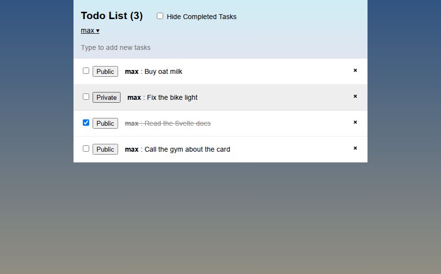

# Simple Todos

A real-time todo list with user accounts and private tasks, built with **Meteor**, **Svelte** and **MongoDB** (2020). Open it in two browser windows and changes show up in both instantly.



## What it shows

- **Reactive data:** Svelte components subscribe to a MongoDB collection through Meteor; the list and the "tasks left" counter update live.
- **Methods with checks:** inserts, deletes and updates go through server methods that validate input and the user.
- **Publications:** the server only sends public tasks plus your own private ones.
- **Accounts:** sign up and sign in with username and password (accounts-ui).
- **Tests:** server-side method tests with Mocha and Chai.

Built by following Meteor's Svelte tutorial, as a test of Meteor + Svelte together.

## Run it

Needs the [Meteor](https://docs.meteor.com/about/install.html) launcher; it fetches the project's own Meteor 1.10 release, Node and MongoDB on first run.

```bash
meteor npm install
meteor run
# open http://localhost:3000
```

Checked again in 2026: it still starts and runs unchanged.
